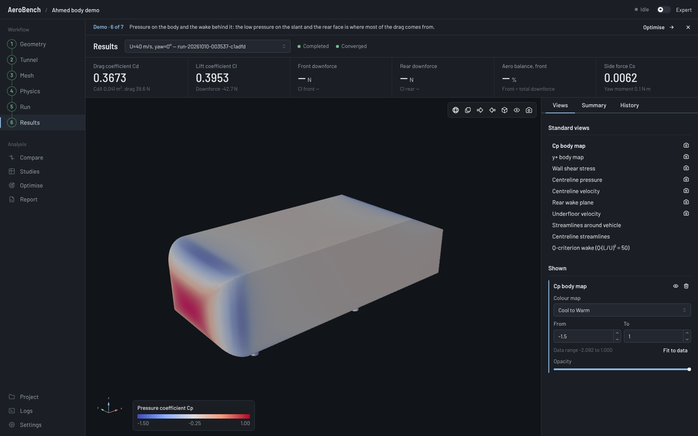
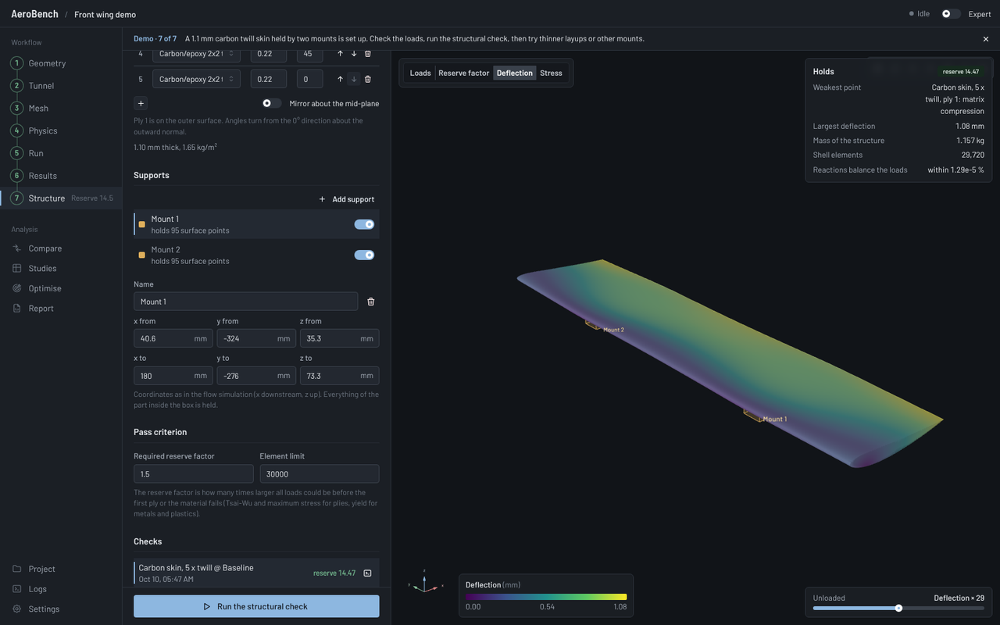

# AeroBench

**Simulate the airflow around a car or a wing on your own Windows PC — no coding, no
command line.** AeroBench is a free program that puts a vehicle or a wing in a virtual wind
tunnel, works out the forces on it (drag, downforce), shows where the air pushes and pulls,
can try shape changes to improve it, and can check whether a carbon wing is strong enough.
It is made for people who are new to simulation (CAE). Behind the scenes it drives two
well-known free engineering programs, OpenFOAM (airflow) and CalculiX (strength).

> [!WARNING]
> **Early, experimental software.** AeroBench is a personal project in an early state. Most
> features have been tested only lightly, and some not at all on real Windows computers. It
> may crash, stop halfway, or give results that are wrong. Do not rely on its numbers for
> anything that matters without checking them some other way. If something goes wrong,
> please tell us (see [Something went wrong?](#something-went-wrong)) — feedback,
> suggestions and your own modifications are very welcome.

AeroBench is free and open-source software under the GNU General Public License v3.0 or
later. It has no accounts, licence keys or telemetry, and what you make with it is yours.
This offering is not approved or endorsed by OpenCFD Limited, producer and distributor of the
OpenFOAM software via www.openfoam.com, and owner of the OPENFOAM® and OpenCFD® trade marks.



## Install it (Windows 10 or 11, 64-bit)

You need about 4 GB of free disk space and an internet connection for the download (about
550 MB).

1. Open the [latest release](https://github.com/potatodude321/Aerobench/releases/latest)
   page.
2. Scroll down to **Assets** and click **`AeroBench-Setup-0.2.2.exe`** (the version number
   may be higher). Your browser downloads it. If the browser asks whether to keep the file,
   choose **Keep**.
3. Open the downloaded file (double-click it in your *Downloads* folder).
4. Windows will probably show a blue box saying **"Windows protected your PC"**. This is
   because the installer is not signed by a company yet, not because something is wrong.
   Click **More info**, then **Run anyway**.
5. Windows asks **"Do you want to allow this app to make changes to your device?"** — click
   **Yes**.
6. Click through the setup. It installs everything AeroBench needs in one go (OpenFOAM,
   ParaView, CalculiX and Microsoft MPI); this takes a few minutes.
7. Start **AeroBench** from the Start menu or the desktop shortcut.

To update later, download the new version and install it the same way, over the old one.
Your projects are kept.

## Your first simulation

1. On the start screen, under **Or try a demo**, click **Open the demo** next to
   **Ahmed body** (a simple car-like shape used by researchers) or **Front wing**.
2. A short guide appears above each page. Follow the steps on the left from top to bottom:
   *Geometry → Tunnel → Mesh → Physics → Run → Results*.
3. On **Run**, click **Run simulation**. A first run takes from a few minutes to an hour,
   depending on your computer. You can close AeroBench meanwhile; the run carries on.
4. On **Results**, read the drag and downforce numbers and look at the coloured pressure map.

To use your own car or wing, fill in **New project** on the start screen (a name and a folder
to keep it in), click **Create project**, then import its 3D file (STL, OBJ, STEP or IGES) on
the **Geometry** page. The [user guide](docs/user-guide.md) explains every page.



## Something went wrong?

That is useful to know — please report it, even if you are not sure it is a bug:

1. Go to the [Issues](https://github.com/potatodude321/Aerobench/issues) page (you need a free
   GitHub account) and click **New issue → Bug report**.
2. Say what you were doing and what happened. A screenshot helps.
3. If a run or mesh failed, open the **Logs** page in AeroBench (or the *log* link next to the
   failed run), copy the last part and paste it into the report.

Ideas and wishes are welcome too: **New issue → Feature request**. If you change AeroBench
yourself, you are welcome to share it — see [Contributing](#contributing).

## What it can do

* **Bring in a 3D model** of a car, a wing, a flap or a splitter; AeroBench finds the wheels
  and parts, checks the model for holes and fixes common problems.
* **Build the wind tunnel and the mesh** (the grid the airflow is calculated on)
  automatically, with boxes you can drag to add detail where it matters.
* **Run the airflow simulation** and follow it live; get drag, downforce, balance and side
  force, and see pressure maps, streamlines and the wake.
* **Compare designs, run studies and optimise**: one click for "lower drag" or "more
  downforce", or set up your own.
* **Check a wing's strength** under the air loads with a carbon or metal skin.
* **Make a report** (HTML or PDF) with the results and pictures.

AeroBench also runs on Linux for development, using your own OpenFOAM installation.

## Features in detail

For readers who know CFD and FEA:

| Area | Capabilities |
|---|---|
| Geometry | STL (ASCII multi-solid / binary), OBJ, PLY, STEP, IGES, BREP (OpenCASCADE tessellation, one region per solid); unit and orientation detection; diagnostics (open edges, non-manifold, inverted normals, islands); repair pipeline; automatic component and wheel identification; more bodies from the same CAD model added in place (as parts, or as modelled refinement volumes); frontal area; ride height and rake |
| Wind tunnel | Domain presets in vehicle lengths with blockage ratio; moving or stationary ground; rotating wheels (rotating-wall velocity); yaw by rotated inflow with free-stream far field; half model; contact-patch treatment |
| Mesh | Automatic snappyHexMesh plan (surface, wake, underbody, wheel and front refinement regions); your own boxes edited by dragging in the 3D view, mirrored copies, modelled refinement volumes, overlap-aware estimate; boundary layers sized for a target y+; parallel meshing; checkMesh and layer-coverage reporting with engineering findings |
| Physics & numerics | Steady incompressible RANS (k-ω SST, Spalart–Allmaras, realizable k-ε); versioned numerics presets (robust → high fidelity) with first-order start; derived quantities (Re, y+, inlet turbulence) shown before running |
| Execution | Native Windows OpenFOAM v2606 (MinGW + MS-MPI, one parallel job at a time), Linux; detached job runner (closing the app never kills a run); crash-safe resume; exact commands recorded |
| Results | Cd, Cl, axle loads, aero balance, side force, moments with explicit sign conventions; per-component forces; drag decomposition; convergence assessment (never "converged" unless the criteria pass) |
| Visualisation | ParaView 6.2 as the processing engine: Cp/y+/wall-shear maps, planes, streamlines, Q-criterion — rendered in the app; one click to open the case in ParaView; generated pvpython scripts |
| Compare | Deltas and percentages where meaningful, validity warnings (different reference values, unconverged runs), side-by-side 3D views with synced cameras |
| Studies | One-factor sweeps, full factorial, Latin hypercube, tables; yaw sweeps on a single mesh; mesh-sensitivity studies with grid convergence index |
| Optimisation | Bayesian optimisation (GP, constrained EI), NSGA-II (multi-objective), Nelder–Mead, space-filling; constraints absolute or relative to baseline; multi-condition objectives; failures as data; checkpoint/resume |
| Parameterisation | Shape zones (boxes where the optimiser may reshape, with vehicle and aero-element presets, coverage and movement heat maps); rigid moves, FFD and RBF morphs of chosen components with validity checks (folds, self-intersection, enclosure, ground contact) |
| Structural check | Aero elements: loads from a run on a shell model remeshed from the same surface, sheet and composite sections, CalculiX, ply failure (Tsai-Wu, maximum stress), deflection and reserve-factor maps |
| Reports | Self-contained HTML (charts, ParaView images, provenance), CSV, PDF export |

## Building from source

See [docs/developer-setup.md](docs/developer-setup.md) for the full setup and
[docs/packaging.md](docs/packaging.md) for building the Windows installer.

```bash
# engine
cd engine && python -m venv .venv && . .venv/bin/activate && pip install -e .[dev,cad]
python -m pytest tests/unit            # fast tests, no OpenFOAM needed
python -m pytest tests/integration     # real OpenFOAM v2606 + ParaView pipeline
aerobench doctor                        # environment check

# desktop
cd desktop && npm ci && npm run build && npx electron .
```

## Documentation

* [User guide](docs/user-guide.md)
* [Validation](docs/validation.md) and [benchmarks](docs/benchmarks.md) — what is and is not claimed
* [Architecture](docs/architecture.md) and [design decisions (ADRs)](docs/adr/)
* [Domain model](docs/domain-model.md), [OpenFOAM compatibility](docs/openfoam-compatibility.md),
  [ParaView integration](docs/paraview-integration.md)
* [Developer setup](docs/developer-setup.md), [packaging](docs/packaging.md)
* [Third-party components and data](docs/third-party.md)
* [Roadmap](docs/roadmap.md)

## Contributing

AeroBench is not thoroughly tested, so every report helps. Feedback, recommendations, test
results on your own cars and wings, comparisons with wind-tunnel data, and your own changes to
the code are all welcome — see [CONTRIBUTING.md](CONTRIBUTING.md) and the
[code of conduct](CODE_OF_CONDUCT.md). Report security problems privately as described in
[SECURITY.md](SECURITY.md).

## Repository layout

```
engine/            Python engine (domain model, OpenFOAM case generation, execution, results, API)
  src/aerobench/
    domain/        typed, versioned project model (Pydantic) and validation
    foam/          dictionary AST/parser/writer, fork adapters, case builder, log parsers
    geometry/      surface IO, diagnostics, repair, components, pose, parameterisation
    meshing/       mesh planning and layer design
    execution/     providers: native Windows, local POSIX (Linux), remote (interface)
    jobs/          detached runner, job manager, per-project worker
    results/       force ingestion, metrics; monitoring/ convergence assessment
    viz/           ParaView sidecar client + server (pvpython), presets, binary payloads
    studies/       design space, DOE, design evaluation, study driver
    optimisation/  ask/tell optimisers, Gaussian process
    validation/    benchmarks (Ahmed body), grid convergence index
    services/      application services used by the API
    api/           FastAPI service (localhost, per-launch token, WebSocket events)
  tests/           unit, integration (real OpenFOAM/ParaView), fixtures from real runs
desktop/           Electron + React + TypeScript shell (Mantine UI, three.js viewport, ECharts)
docs/              architecture, domain model, compatibility, validation, ADRs, guides
packaging/         Windows build scripts (bundled OpenFOAM/ParaView/MS-MPI, embedded Python, electron-builder)
```

## Principles

1. **Never fake results.** Every number comes from stored solver output; missing data is shown
   as missing; unconverged and diverged runs are labelled as such everywhere, including reports.
2. **Traceability.** Each run stores its frozen configuration, generated files, exact commands,
   solver and ParaView versions, hardware and environment digest; any run can be reproduced.
3. **Engineering defaults, expert access.** Presets are versioned and explained; Expert Mode
   shows and overrides every generated dictionary with a recorded diff.
4. **Explicit conventions.** Coordinates and force/moment signs are defined once
   ([ADR-0007](docs/adr/0007-coordinates-and-sign-conventions.md)) and printed with results.

## Licence

Copyright © 2026 Abdul Mahmood and the AeroBench contributors.

AeroBench is free software: you can redistribute it and/or modify it under the terms of the
GNU General Public License as published by the Free Software Foundation, either version 3 of
the License, or (at your option) any later version. It is distributed in the hope that it
will be useful, but WITHOUT ANY WARRANTY; without even the implied warranty of
MERCHANTABILITY or FITNESS FOR A PARTICULAR PURPOSE. See [LICENSE](LICENSE) for the full text.

**What you create is yours.** Projects, geometry, generated case files, meshes, results,
images and reports made with AeroBench belong to you, and you may use them however you like,
commercially or not. As an additional permission under section 7 of the GPL, the parts of
AeroBench's own templates that appear in that output (for example the layout of a report or
the headers of generated files) may be used, copied and modified without the GPL's
conditions.

AeroBench runs OpenFOAM, ParaView, CalculiX and MPI as separate programs. The Windows
installer redistributes them under their own licences (OpenFOAM: GPL-3.0-or-later; CalculiX:
GPL-2.0-or-later; ParaView: BSD-3-Clause with the licences of its libraries; Microsoft MPI:
MIT). Their licence texts are installed with the application, and the source code of the GPL
programs is attached to every release. Details: [docs/third-party.md](docs/third-party.md).

## Trade marks

OPENFOAM® is a registered trade mark of OpenCFD Limited, producer and distributor of the
OpenFOAM software via www.openfoam.com. ParaView is a trade mark of Kitware, Inc. Microsoft is
a trade mark of the Microsoft group of companies. Other names may be trade marks of their
owners; their use here only identifies the software AeroBench works with.
